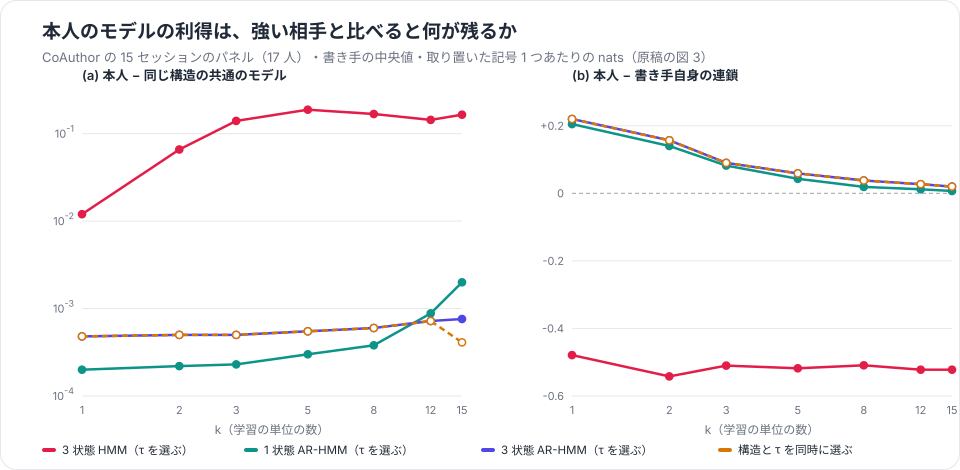
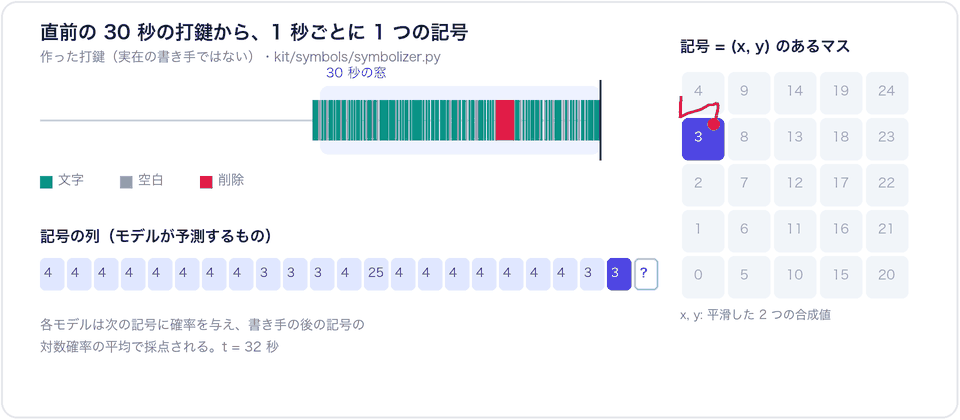
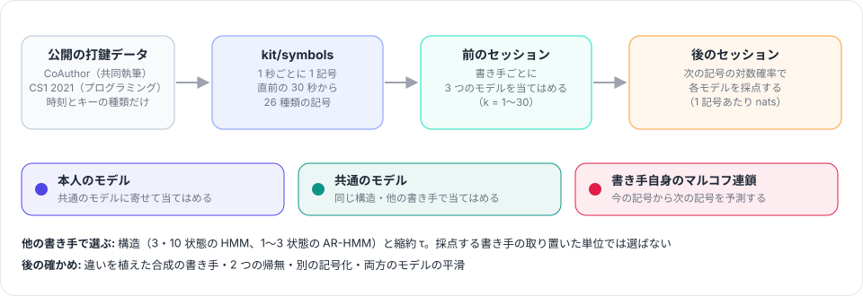

<p align="center">
  
</p>

<p align="center">
  打鍵の振る舞いの「本人のモデル」を、同じ構造の共通のモデルと、書き手自身のマルコフ連鎖と比べた研究の<br>
  コード・計算の前に置いた条件・集計の結果。
</p>

<p align="center">
  <a href="LICENSE-MIT"></a>
  <a href="LICENSE-docs"></a>
  
  
  
  <a href="https://doi.org/10.5281/zenodo.24395569"></a>
</p>

<p align="center"><a href="README.md">English</a> | <b>日本語</b></p>

この repo は、原稿 *Per-person sequence models of keystroke behaviour: what remains of the gain against stronger
comparisons*（三浦尊統）に付く公開物です。記号化の kit、4 つの解析と後の 12 の確かめの当てはめと評価のコード、
計算の前にコミットした条件、集計と合成の値、原稿と補足（Online Resource 1）の LaTeX を収めています。

## 1 枚の図で見る結果

<p align="center">
  
</p>

- **弱い相手と比べると、利得は大きく見える。** CoAuthor では、書き手ごとの 3 状態 HMM が同じ構造の共通のモデルを
  1 記号あたり最大 0.19 nats 上回る（図 a の赤）。しかしその構造は、書き手自身の 1 次のマルコフ連鎖に約 0.5 nats
  負ける（図 b の赤）。
- **強い相手と比べると、ほとんど残らない。** より強い構造と、他の書き手で選んだ縮約（橙）では、学習 5 回と 15 回で
  約 5 &times; 10<sup>-4</sup> nats が残る。共通のモデルが自分の平滑を外したときに伸びる幅を超えない。
- **残りは、人ごとの違いを示しも否定もしない。** 人ごとの違いの無い合成の書き手でも同じ程度の残りが出た。
  3 &times; 10<sup>-2</sup> までの植えた違いは安定しては見つからなかった。他の読み（両側の平滑の当て直し・CS1）と
  限界は原稿にあります。

図の値は CoAuthor の 15 セッションのパネル（17 人）の書き手の中央値で、`paper/figdata/`（原稿の図 3）から読んでいます。
`tools/readme_media.py --check` が、上の図がその値そのものであることを確かめます。

## 打鍵の記録が記号の列になるまで

<p align="center">
  
</p>

1 秒ごとに、直前の 30 秒の打鍵から 5 つの特徴（打鍵の間隔・削除・まとまり・休止）を求め、平滑した 2 つの値
*x* と *y* にまとめます。5 &times; 5 の格子のどのマスに入るかがその秒の記号で、記号 25 は削除の連打の後の最初の
入力を表します。使うのは打鍵の時刻と種類だけで、文字は読みません。アニメーションは
[`kit/symbols`](kit/symbols/README.md) を作った打鍵（種 20261120）に当てたもので、記号化の説明のための図であり、
結果ではありません。

## 何と何を比べるのか

<p align="center">
  
</p>

各モデルは、書き手の後のセッションで、実際に続いた記号に与えた確率の対数の平均（1 記号あたりの nats・高いほど
よい）で採点します。本人のモデルの構造と縮約は他の書き手で選び、採点される書き手の取り置いたセッションでは
選びません。

## 原稿のどこが、どのディレクトリから来るか

| 原稿（Online Resource 1 の S8） | `experiments/` の下 | 主なスクリプト |
|---|---|---|
| 解析 1: 本人の 3 状態 HMM 対 共通のモデルと自身の連鎖 | `20261103-coauthor-per-person` | `perperson.py`, `hmm.py`, `build_obs.py` |
| 解析 2: 他の書き手で選ぶ構造と &tau; &le; 10<sup>4</sup> | `20261104-coauthor-ml-improve` | `ml.py`, `hmm2.py`, `hmm_b.py`, `data.py` |
| 解析 3: &tau; の格子の拡張と同時の選び | `20261104-timeseries-tau-extend` | `ml.py`, `hmm2.py`, `data.py` |
| 解析 4: 事前の最頻値と平滑の効果 | `20261106-tau-mode-candidate` | `ml.py`, `hmm2.py` |
| 確かめ 1: 平滑なし・重ならない記号と擬似残差（S13） | `20261107-unsmoothed-residual-check` | `build_variants.py`, `fit.py`, `residual.py` |
| 確かめ 2: 構造の補い（S12） | `20261107-structure-deficit-test` | `ml.py`, `hmm2.py`, `forms.py` |
| 確かめ 3: 合成の感度・第 1 の帰無（S10） | `20261110-per-person-sensitivity` | `synth.py`, `run_synth.py`, `analysis.py` |
| 確かめ 4: 合成の書き手への最頻値の分解（S10） | `20261111-sensitivity-mode-decomposition` | `decomp.py`, `run_decomp.py` |
| 確かめ 5: 水準ごとに種 10・誤警報率（S10） | `20261112-sensitivity-ten-seeds` | `ten.py` |
| 確かめ 6: 最頻値を候補に（S6） | `20261111-mode-in-selection` | `sel.py` |
| 確かめ 7・8: 平均で選ぶ・休止の割合（S6） | `20261111-objective-and-pause` | `obj.py` |
| 確かめ 9・10・12: 書き手の二分・平滑の確かめ・先頭の記号を除く（S9・S4） | `20261112-selection-split-and-smoothing` | `ab.py`, `compute.py`, `sym.py`, `ctrl.py`, `r7.py` |
| 確かめ 11: 第 2 の帰無（S10） | `20261113-null-from-shared` | `fit_m0.py`, `null.py` |
| CS1 の取り置きの抽選と変換 | `20261104-cs1-landscape` | `make_holdout_cs1.py`, `build_cs1.py` |
| CoAuthor の変換と取り置きの抽選（上流） | `20261031-*`・`20261101-*`・`20261102-*`（スクリプトだけ） | `convert.py`, `add_feat.py`, `build_coauthor.py`, `make_holdout.py` |

どの実験のディレクトリにも、`conditions*.md`（コードの前に、保存した値の再解析では計算の前にコミット）、
`notes.md`（回したことと分かったこと）、`SEED`、`run.sh`、集計の値・自己検査・変異テストを入れた `results/` が
あります。記録は書いたときのまま日本語です。英語の説明は原稿で、
[`docs/conditions-summary.md`](docs/conditions-summary.md) が条件の文書すべての英語の要約（最初のコミットの時刻つき）
です。正本は日本語の原文です。

## 中身の地図

```
experiments/          上の表の 18 の実験（コード・条件・notes・集計の結果）
kit/symbols/          記号化の kit: 読み込み・記号器・定数・自己検査・適合検査、
                      CoAuthor の全セッションと CS1 2021 の全課題の記号の SHA-256
paper/                原稿と Online Resource 1 の LaTeX、図の値（paper/BUILD.md）
docs/                 条件の英語の要約、README の図
tools/                この公開物の検査（verify.sh）と図のスクリプト
gse-commits.tsv       ファイルごとに、開発の repo に最初と最後に入ったコミットと時刻（UTC）
gse-source.tsv        写した元の開発のコミット
```

## 検査

```
bash tools/verify.sh                 # 誰でも: NumPy の入った python3 と git
bash tools/verify.sh "$DATA_DIR"     # 公開データを下の配置で置いたとき
```

`verify.sh` は、次のすべてが通ったときだけ 0 で終わります。

1. **kit**: 自己検査と、合成の打鍵 300 本を記号化して、解析に使った実装の出力と全行をビット単位で比べる適合検査。
   合成の入力は種から作り直し、同梱のファイルと一致しなければなりません。
2. **SHA-256 の記録**（`tools/check_pins.py`）: 他の実験のコードを使う実験は `pinned*.py` を通して読み込み、
   読み込むファイルが条件で固定した値と違えば止まります。8 本すべてが読み込めること。`results/provenance*.json`
   に記録したファイルのうち公開物にあるものは、記録の SHA-256 を持つこと（そのまま、または Windows で回した分は
   改行を CRLF にして）。例外は名指しの 1 件で、`sens_report.py` は最初の実行の後に、足した 6 本の複製を読むよう
   書き足しました。陽性対照は 1 バイト変えて失敗を見ます。
3. **README の図**（`tools/readme_media.py --check`）: 上の図が原稿の図の値と同じこと。
4. **公開の検査**（`tools/check_release.py`）と陽性対照: 生データ・書き手の ID・パネルの人数（9 人）以上の大きさの
   入れ物（名指しした合成の場所を除く）・秘密・手元のパスが、ファイルにもコミットの情報にも無いこと。形を見る
   検査で、意味は見ません。
5. `DATA_DIR` を渡したとき: kit の記号の SHA-256 を、CoAuthor と CS1 2021 の生のファイルに当てて照合します。

## 回し直す

NumPy の入った Python 3（実行は Windows で Python 3.11.9 と NumPy 2.4.4、macOS で Python 3.14.4 と NumPy 2.5.2。
版は各 `results/provenance.json` にあります）と、公開データが要ります。

| データ | 入手先 | 置き場 |
|---|---|---|
| CoAuthor v1.0 | <https://coauthor.stanford.edu>（セッションの書庫と 2 つのメタデータ） | `$DATA_DIR/coauthor/raw/` |
| CS1 の打鍵 2021 年版 | Harvard Dataverse, doi:[10.7910/DVN/BVOF7S](https://doi.org/10.7910/DVN/BVOF7S)・version 7.0 | `$DATA_DIR/cs1/raw/2021/keystrokes.csv` |

使ったファイルの SHA-256 は、原稿の Online Resource 1（S3）と、それを読む `run.sh` にあります。

**記号だけ確かめる。** kit は標準ライブラリだけで動きます。

```
cd kit/symbols/hashes
python3 -I hashes.py check coauthor "$DATA_DIR/coauthor/raw/coauthor.zip" coauthor_sha256.csv
python3 -I hashes.py check cs1 "$DATA_DIR/cs1/raw/2021/keystrokes.csv" cs1_2021_sha256.csv
```

件数と不一致の数を出します。一致すれば、手元の記号は解析が読んだ記号と同じです。

**解析を回す。** 各 `run.sh` は回したことの記録です。入力の SHA-256 を確かめ、計算の前に自己検査と変異テストを
回し、書き手ごとの値は repo の外（`$DATA_DIR/landscape/`）に、集計だけを `results/` に書きます。解析が読む変換は
replay の道具 `gse-replay`（SHA-256 `26cae610…33bb3`）を呼びます。そのソースは推定器と一緒に
[stall-runup-equivalence](https://github.com/mikotomiura/stall-runup-equivalence)
（doi:[10.5281/zenodo.24026278](https://doi.org/10.5281/zenodo.24026278)）で公開しています。run.sh はそれを
`$DATA_DIR/klicke/bin/gse-replay` に置く前提です。作業ツリーがコミット済みであることや、当時著者が渡した入力の
一覧のハッシュを確かめる run.sh もあります。これらは記録の一部で、写しでは外して構いません。順番は上の表の順
（ディレクトリ名は日付）です。

## 入れていないものと理由

- **データと、実在の書き手ごとの値。** 公開データとこのコードから誰でも計算し直せるので、公開は集計と合成の値に
  絞りました。感度の確かめと帰無の合成の書き手は、書き手ごとに残しています（`results/replicates/`）。コードが
  作った書き手です。集計には、原稿と同じく、休止の割合のような書き手の範囲も含みます。
- **取り置いた書き手の一覧。** スクリプトが `SEED` の種でデータから引き直します（`make_holdout.py`・
  `make_holdout_cs1.py`）。
- **開発の repo の残り。** 実験は非公開の repo から写しました。記録の中のコミットの id はその repo を指し、著者の
  照合のために残しています。`gse-commits.tsv` は、ファイルごとにそこへ最初と最後にコミットした時刻を示すので、
  条件と結果がいつコミットされたかを比べられます。
- **開発の写しと違うファイルは 1 つだけ:** `paper/supplement.tex` で、頭のコメントを 2 行短くし、空の頭の行を
  残しました。他のファイルはすべて `gse-source.tsv` のコミットとバイト単位で同じです。

## 引用と許諾

この公開物（doi:[10.5281/zenodo.24395569](https://doi.org/10.5281/zenodo.24395569)・`CITATION.cff`）と原稿を
引用してください。コード（`tools/`・`kit/symbols/` の Python・`experiments/` の下のスクリプト）は MIT と
Apache-2.0 のどちらかを選べます。記録・結果・図・文書は CC BY 4.0（`LICENSE-docs`）です。データはそれぞれの
条件に従います: CoAuthor（Lee, Liang and Yang, CHI 2022）、CS1 の打鍵データ（Edwards, Hart and Shrestha,
Journal of Educational Data Mining, 2023）。
