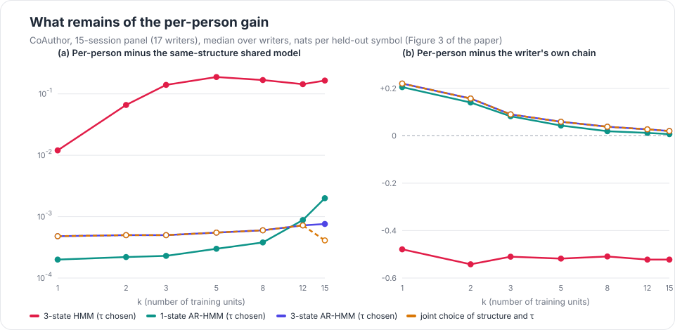
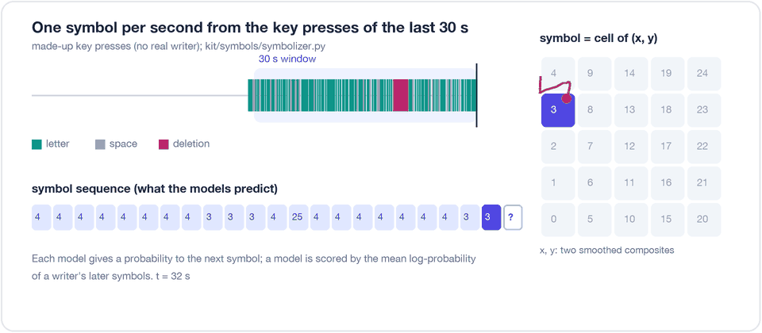
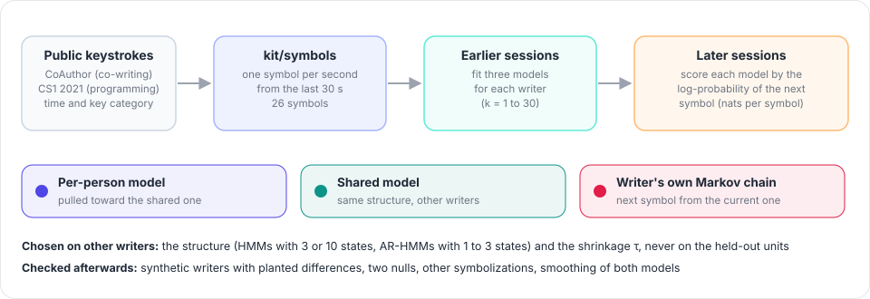

<p align="center">
  
</p>

<p align="center">
  Code, conditions and aggregate results of a study of per-person sequence models of keystroke behaviour,<br>
  compared with a same-structure shared model and with the writer's own Markov chain.
</p>

<p align="center">
  <a href="LICENSE-MIT"></a>
  <a href="LICENSE-docs"></a>
  
  
  
  <a href="https://doi.org/10.5281/zenodo.24395569"></a>
</p>

<p align="center"><b>English</b> | <a href="README.ja.md">日本語</a></p>

This repository accompanies the manuscript *Per-person sequence models of keystroke behaviour: what remains of the gain
against stronger comparisons* (Mikoto Miura). It holds the symbolization kit, the fitting and evaluation code of the
four analyses and the twelve later checks, the conditions committed before each computation, the aggregate and
synthetic results, and the LaTeX sources of the manuscript and its supplement (Online Resource 1).

## The finding in one figure

<p align="center">
  
</p>

- **Against a weak comparison the gain looks large.** In CoAuthor, a per-writer three-state HMM beats a shared model
  of the same structure by up to 0.19 nats per symbol (panel a, red), but that structure loses to the writer's own
  first-order Markov chain by about 0.5 nats (panel b, red).
- **Against a stronger comparison little remains.** With a stronger structure and the shrinkage chosen on other
  writers (orange), about 5 &times; 10<sup>-4</sup> nats per symbol remains at five and fifteen training sessions,
  no more than the shared model gains when its own smoothing is removed.
- **The remainder neither shows nor rules out per-person differences.** Synthetic writers without per-person
  differences left a similar remainder, and planted differences up to 3 &times; 10<sup>-2</sup> were not reliably
  detected. The manuscript gives the other readings (the symmetric refit, CS1) and every limit.

The plotted values are medians over the 17 writers of the 15-session CoAuthor panel, read from
`paper/figdata/` (Figure 3 of the manuscript); `tools/readme_media.py --check` confirms that the figure above holds
exactly those values.

## How a keystroke log becomes a sequence

<p align="center">
  
</p>

Every second, five features of the key presses in the preceding 30 seconds (flight time, deletions, bursts, pauses)
are combined into two smoothed values *x* and *y*; the cell of a 5 &times; 5 grid they fall in is the symbol of that
second, and symbol 25 marks the first typing after a run of deletions. Only the time and the category of each key
press are used; no characters are read. The animation runs [`kit/symbols`](kit/symbols/README.md) on made-up key
presses (seed 20261120); it illustrates the coding and is not a result.

## What is compared

<p align="center">
  
</p>

Each model is scored on a writer's later sessions by the mean log-probability it gives to the symbols that actually
follow (nats per symbol; higher is better). The structure and the shrinkage of the per-person model are chosen on
the other writers, never on the held-out sessions of the writer being scored.

## Where each part of the manuscript comes from

| Manuscript (Online Resource 1, S8) | Directory under `experiments/` | Main scripts |
|---|---|---|
| Analysis 1: per-person 3-state HMM vs. shared model and own chain | `20261103-coauthor-per-person` | `perperson.py`, `hmm.py`, `build_obs.py` |
| Analysis 2: structures and &tau; &le; 10<sup>4</sup> chosen on other writers | `20261104-coauthor-ml-improve` | `ml.py`, `hmm2.py`, `hmm_b.py`, `data.py` |
| Analysis 3: extended &tau; grid and joint choice | `20261104-timeseries-tau-extend` | `ml.py`, `hmm2.py`, `data.py` |
| Analysis 4: prior mode and smoothing effect | `20261106-tau-mode-candidate` | `ml.py`, `hmm2.py` |
| Check 1: unsmoothed and non-overlapping symbols, pseudo-residuals (S13) | `20261107-unsmoothed-residual-check` | `build_variants.py`, `fit.py`, `residual.py` |
| Check 2: structure compensation (S12) | `20261107-structure-deficit-test` | `ml.py`, `hmm2.py`, `forms.py` |
| Check 3: synthetic sensitivity, first null (S10) | `20261110-per-person-sensitivity` | `synth.py`, `run_synth.py`, `analysis.py` |
| Check 4: prior-mode decomposition on synthetic writers (S10) | `20261111-sensitivity-mode-decomposition` | `decomp.py`, `run_decomp.py` |
| Check 5: ten seeds per level, false-alarm rates (S10) | `20261112-sensitivity-ten-seeds` | `ten.py` |
| Check 6: prior mode as a candidate (S6) | `20261111-mode-in-selection` | `sel.py` |
| Checks 7 and 8: choice by the mean, pause share (S6) | `20261111-objective-and-pause` | `obj.py` |
| Checks 9, 10 and 12: writer split, smoothing checks, score without first symbols (S9, S4) | `20261112-selection-split-and-smoothing` | `ab.py`, `compute.py`, `sym.py`, `ctrl.py`, `r7.py` |
| Check 11: second null (S10) | `20261113-null-from-shared` | `fit_m0.py`, `null.py` |
| CS1 holdout draw and conversion | `20261104-cs1-landscape` | `make_holdout_cs1.py`, `build_cs1.py` |
| CoAuthor conversion and holdout draw (upstream) | `20261031-*`, `20261101-*`, `20261102-*` (scripts only) | `convert.py`, `add_feat.py`, `build_coauthor.py`, `make_holdout.py` |

Every experiment directory has `conditions*.md` (committed before its code or, for reanalyses of stored values,
before its computation), `notes.md` (what was run and found), `SEED`, `run.sh` and `results/` with the aggregate
values, the self-tests and the mutation tests. These records are in Japanese, as they were written; the manuscript is
the English account, and [`docs/conditions-summary.md`](docs/conditions-summary.md) summarizes every conditions
document in English with its first commit time (the Japanese originals are authoritative).

## Repository map

```
experiments/          the 18 experiment directories above (code, conditions, notes, aggregate results)
kit/symbols/          the symbolization kit: adapters, symbolizer, constants, self-test, conformance test,
                      per-record SHA-256 of the symbols of every CoAuthor session and CS1 2021 assignment
paper/                LaTeX sources of the manuscript and Online Resource 1, figure data (paper/BUILD.md)
docs/                 conditions summary in English, README figures
tools/                checks of this release (verify.sh) and the figure script
gse-commits.tsv       for every file: the commit and time (UTC) at which it first and last entered the
                      development repository
gse-source.tsv        the development commits this release was copied from
```

## Checks

```
bash tools/verify.sh                 # anyone: needs python3 with NumPy and git
bash tools/verify.sh "$DATA_DIR"     # with the public data downloaded (layout below)
```

`verify.sh` exits with 0 only if all of these pass:

1. **Kit**: the self-test, and the conformance test that symbolizes 300 synthetic key-press sequences and compares
   every row, bit for bit, with traces from the implementation used in the analyses; the synthetic inputs are
   regenerated from their seed and must equal the shipped file.
2. **SHA-256 records** (`tools/check_pins.py`): each experiment that reuses another's code loads it through a
   `pinned*.py` module that stops if a loaded file differs from the value fixed in its conditions; all eight import.
   Every file recorded in a `results/provenance*.json` that is part of this release has the recorded SHA-256 (as
   released, or with CRLF line ends for the runs on Windows), with one listed exception: `sens_report.py` was extended
   after its first run to read six added replicates. Positive controls change one byte and expect a failure.
3. **README figures** (`tools/readme_media.py --check`): the figure above equals the manuscript's figure data.
4. **Release check** (`tools/check_release.py`) and its positive controls: no raw data, no writer identifiers, no
   container as large as a panel (9 writers or more) outside the listed synthetic places, no secret or local path, in
   the files and in the commit metadata. It looks for shapes, not meaning.
5. With `DATA_DIR`: the per-record hashes of the kit against the raw CoAuthor and CS1 2021 files.

## Rerunning

You need Python 3 with NumPy (the runs used Python 3.11.9 with NumPy 2.4.4 on Windows and Python 3.14.4 with NumPy
2.5.2 on macOS; each `results/provenance.json` records its versions) and the public data:

| Data | Where to get it | Place it at |
|---|---|---|
| CoAuthor v1.0 | <https://coauthor.stanford.edu> (the session archive and the two metadata sheets) | `$DATA_DIR/coauthor/raw/` |
| CS1 keystrokes, 2021 release | Harvard Dataverse, doi:[10.7910/DVN/BVOF7S](https://doi.org/10.7910/DVN/BVOF7S), version 7.0 | `$DATA_DIR/cs1/raw/2021/keystrokes.csv` |

The SHA-256 of each file used is in the manuscript's Online Resource 1 (S3) and in the `run.sh` that reads it.

**Symbols only.** The kit needs only the standard library:

```
cd kit/symbols/hashes
python3 -I hashes.py check coauthor "$DATA_DIR/coauthor/raw/coauthor.zip" coauthor_sha256.csv
python3 -I hashes.py check cs1 "$DATA_DIR/cs1/raw/2021/keystrokes.csv" cs1_2021_sha256.csv
```

prints the number of records and of mismatches; equal hashes mean your symbols are the ones the analyses read.

**The analyses.** Each `run.sh` is the record of what was run: it checks the SHA-256 of its inputs, runs the
self-test and the mutation tests before the computation, and writes per-writer values outside the repository
(`$DATA_DIR/landscape/`) and only aggregates to `results/`. The conversion that the analyses read calls the replay
tool `gse-replay` (SHA-256 `26cae610…33bb3`), whose source is released with the estimator in
[stall-runup-equivalence](https://github.com/mikotomiura/stall-runup-equivalence)
(doi:[10.5281/zenodo.24026278](https://doi.org/10.5281/zenodo.24026278)); the run scripts expect it at
`$DATA_DIR/klicke/bin/gse-replay`. Some run scripts also check that the work tree is the committed one, or an input
manifest hash given by the authors at the time; those checks belong to the record and can be removed in a copy. The
order is the order of the table above (directory names are dates).

## What is not here, and why

- **The data and per-writer values of real writers.** Anyone can recompute them from the public data with this code,
  so the release is limited to aggregate and synthetic values. Synthetic writers of the sensitivity checks and the
  nulls are kept per writer (`results/replicates/`); they are made up by the code. Aggregates include, as in the
  manuscript, ranges over writers such as the pause share.
- **The lists of holdout writers.** The scripts redraw them from the data with the seeds in `SEED`
  (`make_holdout.py`, `make_holdout_cs1.py`).
- **The rest of the development repository.** The experiments were copied from a private repository; the commit ids
  in the records refer to it and are given for the authors' own checks. `gse-commits.tsv` gives, for each file, when
  it was first and last committed there, so that a reader can compare when each set of conditions and each result
  was committed.
- **One file differs from the development copy:** in `paper/supplement.tex` two header comment lines are shortened
  and an empty header line is left in place. Every other file is byte-identical to the commits in `gse-source.tsv`.

## Citation and license

Please cite the archive (doi:[10.5281/zenodo.24395569](https://doi.org/10.5281/zenodo.24395569); `CITATION.cff`) and
the manuscript. Code (`tools/`, the Python files of `kit/symbols/`, the scripts under `experiments/`) is licensed
under MIT or Apache-2.0 at your option; records, results, figures and documents under CC BY 4.0 (`LICENSE-docs`). The
datasets keep their own terms: CoAuthor (Lee, Liang and Yang, CHI 2022) and the CS1 keystroke data (Edwards, Hart and
Shrestha, Journal of Educational Data Mining, 2023).
